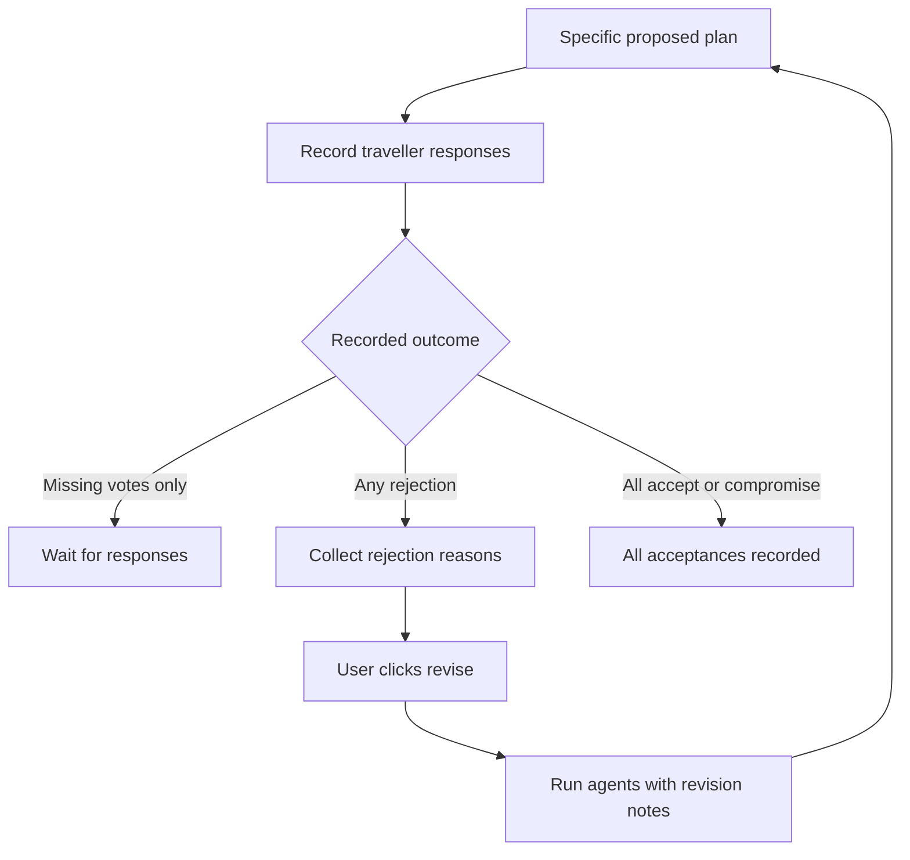

# TripTogether architecture

## Execution model

TripTogether runs three tool-using agents inside a deterministic LangGraph workflow. The Scout and Planner produce structured proposals. Python validation gates their handoffs. The Mediator explains calculated comparisons. Humans record acceptance or rejection through the UI.

Agents may use the same OpenAI model. Separate roles do not require separate services or subscriptions. Calls are sequential in this prototype.

| Stage | Reads | Produces | LLM call? |
| --- | --- | --- | --- |
| Resolve preferences | Original trip and opted-in saved preferences | `effective_trip` | No |
| Scout | Effective trip and destination assessment tool | `scout_report` | Yes |
| Validate Scout | Effective trip, report, and package data | Success or exception | No |
| Planner | Effective trip, shortlist, and activity tool | `planner_report` | Yes |
| Validate Planner | Trip, shortlist, activities, and schedule | Success or exception | No |
| Mediator | Effective trip and comparison tool | `mediator_report` | Yes |
| Voting | Recorded responses to a specific proposal | Agreement status | No |

An empty valid shortlist ends execution before planning. A validation exception stops execution and is shown as a failure; the workflow does not silently accept or repair it.

## State

| Key | Meaning |
| --- | --- |
| `trip` | Original request for the current invocation, including revision notes |
| `effective_trip` | A separately validated request after resolving saved preferences |
| `scout_report` | Structured destination shortlist and explanations |
| `planner_report` | Structured schedules, or `None` while replanning |
| `mediator_report` | Structured recommendation, or `None` while replanning |

The preference-loading node clears obsolete Planner and Mediator reports. New input on a completed thread starts the graph again; it is not a natural-language resume command.

Each agent has its own local message history. The outer workflow shares structured reports rather than merging every agent message into a common conversation. No conversational memory is claimed.

## Memory boundaries

| Data | Storage | Scope |
| --- | --- | --- |
| Graph checkpoints | `triptogether.sqlite` | Trip thread |
| Saved soft preferences | `preferences.sqlite` | Stable demo traveller ID |
| Current UI result and trip ID | Streamlit session state | Browser session |
| Votes | Streamlit session state, keyed by proposal fingerprint | Exact proposal in a session |

Checkpoint serialization explicitly allows the application’s custom Pydantic models. Keep `MediatorReport` registered alongside the earlier trip and report models.

Durable storage alone does not make data “long-term memory.” The cross-trip lookup and preference-resolution behavior create that scope. Current nonempty soft preferences replace, rather than merge with, the saved list. Empty current preferences only trigger fallback when retrieval is opted in.

## Tools and evidence

- The Scout tool captures a copy of the trip; model-supplied arguments cannot replace budgets.
- The Planner tool exposes activities only for validated shortlist destinations.
- The comparison tool derives scores from scheduled activity IDs and the supplied dataset.
- Tool-use checks establish that a named tool ran. They do not prove the final prose accurately reflects its output.
- The Planner uses a synthetic time allowance. It cannot verify actual departure times, local transfers, opening hours, or availability.
- Missing tags or activities mean missing evidence, not proof that a destination lacks an attraction.

## Human decisions and revisions

Rejections take priority over missing votes when displaying status. Accepting with a compromise is explicit acceptance. The shared-screen application cannot verify that a traveller personally supplied their recorded response.

Revision notes are appended without duplicate identical notes. They reach all three agents through trip JSON. Hard constraints remain enforced by existing Python checks, but arbitrary revision requests are not yet converted into executable constraints.

A proposal fingerprint includes the effective trip, full Planner report, recommended destination ID, and thread ID. It excludes the Mediator’s explanatory wording. It is an identifier, not an authentication mechanism. Changes to itinerary explanations also change the fingerprint because the full Planner report is included.

## Operational boundaries

The app uses a local SQLite connection for each workflow operation and closes it afterward. API keys remain in environment variables on the Python side. Checkpoint and preference files are excluded from Git.

Graph recursion limits constrain execution steps; they are not exact model-call or spending limits. API usage grows with generations and revisions. The current design does not implement per-user quotas or a production security boundary.
