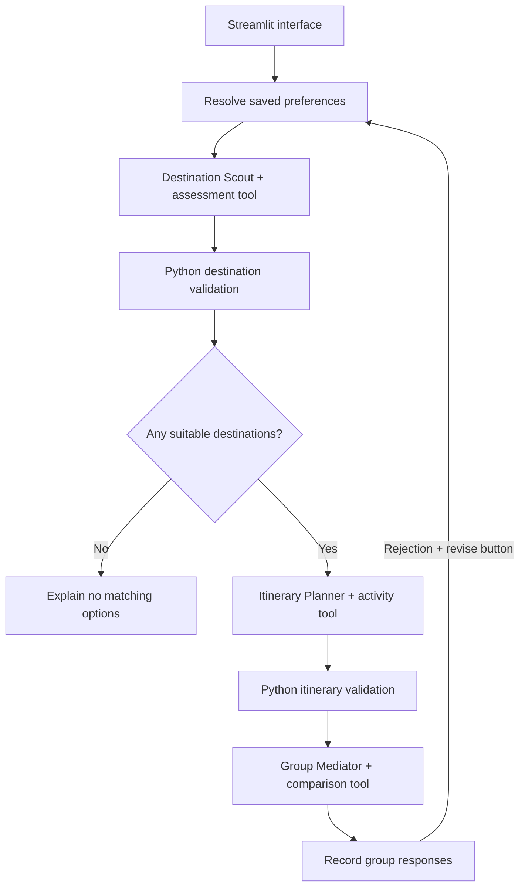

# 🧳 TripTogether

**Different travel styles. One shared plan.**

TripTogether is a local multi-agent group travel planning prototype. It compares sample destinations against each traveller’s budget and requirements, proposes itineraries, explains trade-offs, and lets the group record responses and request revisions.

The central question is: **how can a group choose a trip when everyone wants something different?**

## The experience

1. Enter dates, budgets, interests, and supported hard constraints for three demo travellers.
2. The Destination Scout calls a tool that calculates costs and checks requirements.
3. The Itinerary Planner schedules activities from a supplied dataset.
4. Python validates the destination choices and itinerary structure.
5. The Group Mediator uses calculated interest coverage to explain a recommendation.
6. Record acceptance, acceptance with a compromise, or rejection.
7. Send rejection reasons back to the agents for another proposal.

Voting alone does not call OpenAI. Generating and revising plans does.

## A concrete example

One friend wants cafés and beaches, another wants adventure and nightlife, and a third wants relaxation and sightseeing. Their budgets also differ.

For the supplied four-day, three-night example:

| Sample destination | Estimated cost per person | Budget outcome |
| --- | ---: | --- |
| Rishikesh | ₹11,000 | Within all three initial budgets |
| Jaipur | ₹10,800 | Within all three initial budgets |
| Goa | ₹22,600 | Exceeds all three initial budgets |

Reducing Rahul’s budget to ₹10,000 makes all sample packages fail. The workflow then skips the Planner and Mediator. It does not silently relax the budget.

**All prices, activities, and travel times are fictional sample data. They are not quotes, availability, or booking advice.**

## Architecture



The agents have separate prompts, tools, and responsibilities. A LangGraph workflow controls the handoffs; no extra LLM supervisor is required.

See [ARCHITECTURE.md](ARCHITECTURE.md) for state, memory, validation, and voting details.

## Stack

- Python 3.11
- OpenAI API through `langchain-openai`
- LangChain agents and LangGraph orchestration
- Pydantic models
- SQLite checkpoint and preference storage
- Streamlit interface
- uv dependency management

## Run locally

Prerequisites: Python 3.11, uv, and an OpenAI API key with API billing available.

From the project root:

```bash
uv sync --locked
cp .env.example .env
```

Edit `.env`:

```dotenv
OPENAI_API_KEY=your_actual_api_key_here
OPENAI_MODEL=gpt-4.1-mini
```

Choose a model available to your API account that supports the tool-calling and structured-output features used by the application.

```bash
uv run streamlit run app.py
```

Open the Local URL printed by Streamlit. Keep credentials in `.env`, which must remain outside Git.

## How memory works

**Trip-scoped state:** SQLite checkpoints retain the trip and reports under a `thread_id`. The current UI keeps that ID in Streamlit session state. Checkpoints survive process restarts, but the UI does not yet provide trip recovery after a browser-session reset.

**Cross-trip preferences:** a separate SQLite table stores explicitly saved soft preferences under a stable demo traveller ID. Retrieval is opt-in for each trip. A nonempty current preference list takes priority over the entire saved list. Planning does not automatically save new preferences.

**Voting:** votes are stored in Streamlit session state, not SQLite. They are scoped to a fingerprint of the trip, itineraries, recommended destination, and session trip ID. A changed proposal does not inherit old votes. An identical proposal can retain its existing session votes.

## What is enforced in Python

- Package cost calculations and budget checks.
- Supported overnight-bus and accommodation Wi-Fi requirements.
- Known destination IDs and complete shortlist classification.
- Consecutive itinerary days and correct destination/activity relationships.
- No repeated activities within a destination itinerary.
- A sample 10-hour daily allowance, reduced by outbound/return travel on the first/last day.
- Mediator recommendation must refer to a validated itinerary destination.
- Missing votes do not count as agreement; any rejection blocks agreement.

Pydantic checks structure. Validators check supported rules. Neither establishes that every natural-language explanation is factually correct. Prompt instructions address evidence boundaries, but these are not a complete security or factuality guarantee.

## Interest coverage

For each traveller:

```text
Coverage = distinct stated interests represented by scheduled activities
           / distinct stated interests
```

Matching ignores case and duplicate interests. No stated interests produces an unassessed score. Coverage does not measure happiness, consent, activity quality, or preference strength. The Mediator’s recommendation is not necessarily optimal under a formal fairness objective.

## Validation and demo

See [RELEASE_CHECKLIST.md](RELEASE_CHECKLIST.md) for local checks and failure scenarios, and [DEMO.md](DEMO.md) for a short recording plan.

The check scripts include demonstrations that print results; they are not all assertion-based automated tests. No benchmark pass rate or comparison against a single-agent baseline is claimed.

## Current limitations

- Three fixed demo identities; editing a name does not change its saved-memory identity.
- Delhi sample packages only, with a small synthetic activity dataset.
- No live travel feeds, bookings, weather checks, or verified opening hours.
- Shared local screen: no authentication, private invitations, or verified voter identity.
- Votes are not durable across browser-session resets.
- Revision notes are feedback, not automatically enforced new hard constraints.
- Constraint failures stop the workflow; automatic repair is not implemented.
- No LangSmith integration or measured quality benchmark in this version.
- This is a learning and portfolio prototype, not a production travel service.

## Project files

| File | Responsibility |
| --- | --- |
| `app.py` | Form, comparison, voting, and feedback-driven revisions |
| `models.py` | Traveller, trip, report, and vote schemas |
| `workflow.py` | Shared state and graph routing |
| `destination_scout.py` / `destination_tools.py` | Destination assessment agent and tool |
| `itinerary_planner.py` / `planner_tools.py` | Activity planning agent and tool |
| `group_mediator.py` | Comparison and recommendation agent |
| `cost_calculator.py` / `constraint_checker.py` | Deterministic package checks |
| `scout_validator.py` / `planner_validator.py` | Output validation |
| `plan_comparison.py` | Per-traveller interest coverage |
| `checkpoint_storage.py` | SQLite checkpoint lifecycle and serializer allowlist |
| `preference_memory.py` / `resolve_preferences.py` | Saved soft preferences and precedence |
| `voting.py` | Explicit agreement rules |
| `destination_data.py` / `activity_data.py` | Data loading and validation |
| `destinations.json` / `activities.json` | Fictional sample packages and activities |

## Possible next steps

- Broader, source-backed activity data with freshness timestamps.
- Structured revision requests that Python can verify.
- Authenticated private traveller forms and durable voting.
- User-facing saved-trip recovery.
- Evaluation datasets covering unsupported claims and conflicting requests.
- Compare the quality, latency, and cost of this design against a single-agent baseline.
